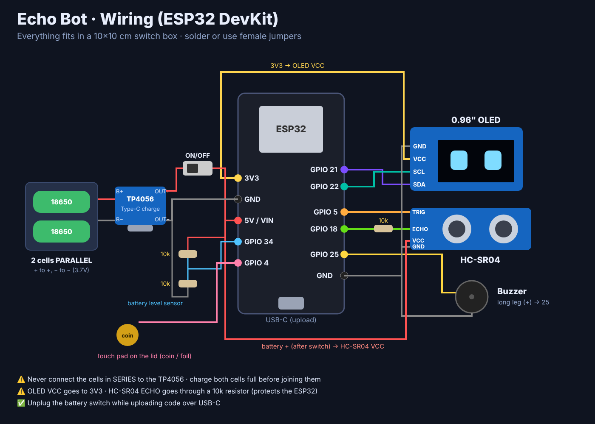

# 🤖 Echo Bot

A pocket desk companion that fits in a **10×10 cm switch box**.
It has an OLED face with moods, wakes up when you come near, beeps like R2-D2, keeps you studying, and you can control it from your phone **with no internet**.

Built by **Reno** ([@renaldibosco](https://github.com/renaldibosco)).



---

## ✨ What Echo can do

### 1 · On its own (fully offline)
| Mode | What it does | Touch |
|---|---|---|
| 👀 **Face** | Blinks, looks around, shows moods. Says hi when you come near. Gets sleepy if you're away for 3 min | tap = pet it (5 fast taps = 😍) |
| ⏱️ **Study timer** | Pomodoro: 25 min focus + 5 min break, with a melody at the end | tap = start / pause |
| 🎲 **Decide** | Dice + coin + YES/NO | tap = roll |
| 📏 **Distance** | Live distance in cm | – |
| 🎵 **Air piano** | Move your hand 5–45 cm away to play 8 notes | – |
| 🚨 **Guard** | Alarm if someone moves in front of it | tap = arm / disarm |
| 📡 **Wi-Fi scan** | Lists nearby networks + signal bars | tap = scan |
| 🐤 **Flappy** | Flappy Bird on the OLED, best score is saved | tap = flap |
| 🔋 **Battery** | Voltage, %, awake time | – |

Always running: 💧 water reminder (every 60 min), 🍛 meal reminders (8:30 / 13:30 / 20:30, after the phone sets the time), 🔋 "I'm hungry, charge me!" at 15%.

**Hold the touch pad** (≈0.7 s) to open the **menu** → tap = next, hold = open.

### 2 · With your phone (offline, Echo makes its own Wi-Fi)
1. On your phone, join Wi-Fi **`Echo-Bot`**, password **`echo1234`**
2. The control page opens by itself. If it doesn't, open **http://192.168.4.1** in Chrome
3. If Android says *"no internet"*, choose **Keep connection / Stay connected**

From the page you can send messages to Echo's screen, change its mood and mode, run the study timer, set reminders, arm the guard, **find my bot** (it beeps), scan Wi-Fi, and sync the clock. The clock syncs automatically when the page opens.

### 3 · Coming next: laptop AI brain
Echo can also join your phone hotspot (bottom of the phone page). Then the laptop's offline AI (Ollama) can talk to it through `http://<echo-ip>/api/say?text=Hello&mood=happy`.

---

## 🧰 Parts
| Part | Notes |
|---|---|
| ESP32 DevKit (Type-C) | ESP32-S3 also works (see pins below) |
| 0.96" OLED I2C (SSD1306, 4 pins) | |
| HC-SR04 ultrasonic | |
| Mini buzzer | passive = melodies, active = beeps only (set in `config.h`) |
| TP4056 Type-C module (with protection, OUT+/OUT−) | charges **1 cell / parallel cells only** |
| 2 × 18650 in **parallel** | same type, both fully charged before joining |
| Slide switch | |
| 3 × 10k resistors | 2 for the battery sensor, 1 for HC-SR04 ECHO |
| Coin / foil / copper tape | touch pad on the lid |

## 🔌 Wiring
| From | To ESP32 (DevKit) | ESP32-S3 |
|---|---|---|
| OLED VCC / GND | 3V3 / GND | 3V3 / GND |
| OLED SDA / SCL | GPIO 21 / 22 | GPIO 8 / 9 |
| HC-SR04 TRIG | GPIO 5 | GPIO 5 |
| HC-SR04 ECHO | **10k →** GPIO 18 | 10k → GPIO 6 |
| HC-SR04 VCC / GND | battery + (after switch) / GND | same |
| Buzzer + / − | GPIO 25 / GND | GPIO 7 / GND |
| Touch pad wire | GPIO 4 | GPIO 4 |
| Battery sensor | battery+ → 10k → **GPIO 34** → 10k → GND | GPIO 1 |
| TP4056 OUT+ | switch → **5V / VIN** | same |
| TP4056 OUT− | GND | GND |

> ⚠️ **Safety**
> - Never connect cells in **series** to the TP4056. It only charges 3.7 V.
> - Turn the **switch OFF** when the ESP32 is plugged into the laptop by USB.
> - Don't use swollen, dented, or hot cells. Tape any torn wrapper.

---

## 💻 Upload the code (Arduino IDE 2)
1. **File → Preferences → Additional boards manager URLs**, paste:
   `https://espressif.github.io/arduino-esp32/package_esp32_index.json`
2. **Boards Manager** → search **esp32** → install **esp32 by Espressif Systems**
3. **Library Manager** → search **Adafruit SSD1306** → Install → choose **Install all** (adds GFX + BusIO)
4. Download this repo (**Code → Download ZIP**), unzip, and open `firmware/EchoBot/EchoBot.ino`
5. **Tools → Board → esp32 → ESP32 Dev Module** (or **ESP32S3 Dev Module**)
6. **Tools → Port →** your COM port
   - No port? Look at the chip near the USB port: **CH340** or **CP2102**, and install that driver
7. Click **Upload ➜**. If it gets stuck on `Connecting....`, hold the **BOOT** button until it starts.

Open **Serial Monitor** (115200) to see `Echo ready...`.

## ⚙️ Settings: `firmware/EchoBot/config.h`
- Wi-Fi name / password, your name
- `BUZZER_PASSIVE` → `false` if your buzzer only beeps one tone
- `USE_TOUCH_PIN` → `0` to use a push button / TTP223 instead of a coin
- Sleep time, presence distance, long-press time

## 🛠️ Troubleshooting
| Problem | Fix |
|---|---|
| OLED blank | Check VCC on **3V3**, swap SDA/SCL, check Serial Monitor for `OLED not found` |
| Touch reacts by itself | Use a shorter wire to the coin, or set `USE_TOUCH_PIN 0` and use a button |
| Distance shows `--` | Check TRIG/ECHO and give HC-SR04 VCC from battery+ (it needs >3.7 V) |
| Restarts when Wi-Fi starts | The battery is low, or the ESP32 board needs more voltage. Charge it first |
| Battery shows 0% | The divider isn't connected to GPIO 34 (Echo still works) |
| Phone page won't open | Turn mobile data OFF, then open http://192.168.4.1 |

## 📁 Files
```
firmware/EchoBot/EchoBot.ino   ← open this in Arduino IDE
firmware/EchoBot/echo_main.cpp ← Echo's brain (all the code)
firmware/EchoBot/config.h      ← your settings & pins
firmware/EchoBot/webpage.h     ← the phone control page
docs/wiring.png                ← wiring diagram
```
